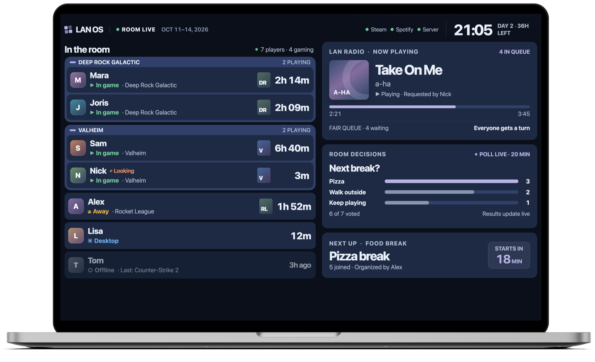
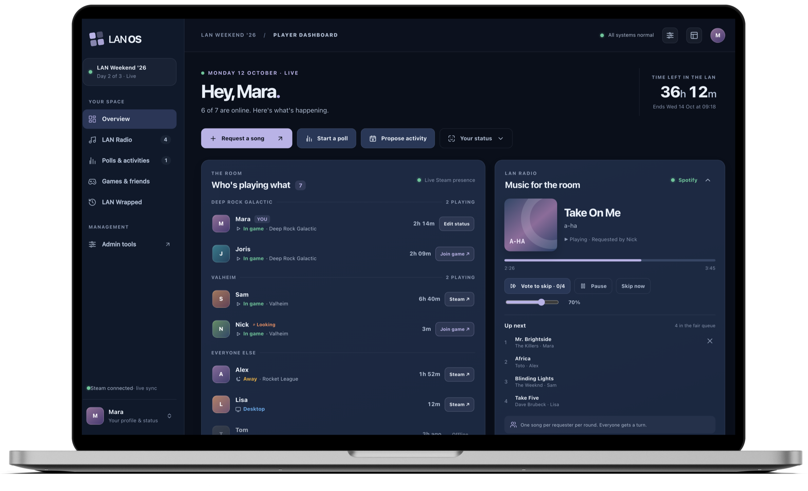
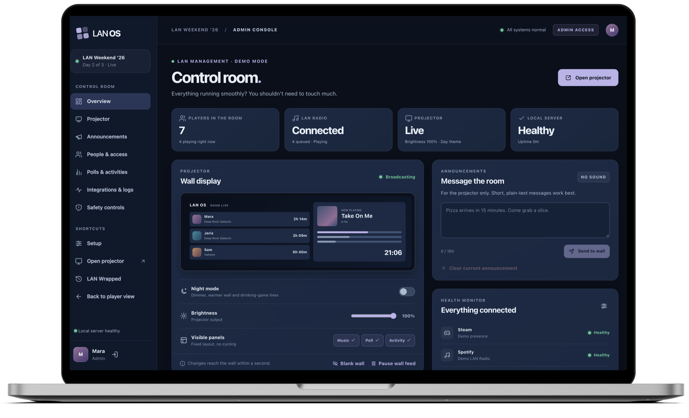

# LAN OS

LAN OS turns a LAN weekend into one shared, live overview. It runs on one Windows PC in the room. Everyone can see who's playing what, the music runs itself, group plans are one click away, and the weekend ends with a recap that's kept year after year.

It has three screens:

- **The projector wall**, on all weekend and readable from across the room.
- **A dashboard for every player**, in their own browser.
- **An admin page** for the host and a few trusted friends.

Everything stays on your own network. Nothing needs to be installed on the players' PCs.

---

## The projector wall



A fixed 1920×1080 layout that scales to any projector or TV, readable from 4 metres.

- **In the room:** a card for every player with their Steam avatar, status, game, game cover and how long they've been playing. Players in the same game are grouped together. Offline players are greyed out with their last game.
- **Status at a glance:** In game, Desktop, Away, Offline, Hidden or Looking for players. Each status always has a colour, an icon and a word.
- **LAN Radio:** the song playing now, its album art, a progress bar, who requested it, and the next song when this one is almost done.
- **Room decisions:** the running poll with live results, the time left, and the result when it closes.
- **Next up:** the next group activity with a countdown, or what's happening right now.
- **Clock:** the time, "Day 2", and the hours left in the LAN.
- **Health dots** for Steam, Spotify and the server.
- **Announcements:** short lines about real moments, such as long sessions, poll results, everyone in the same game, or a rare combination like everyone on the desktop at once. Big moments get a large overlay, small ones a banner.
- **Night mode:** a dimmer, warmer wall, and announcements in a drinking-game tone.
- **Never silent, never stuck:** the wall makes no sound and reconnects by itself if anything restarts.

## The player dashboard



- **Who's playing what:** the same live roster as the wall, with session times. Each friend has a **Join game** button when Steam shows a lobby or server you can join, otherwise **Steam ↗** to open their profile.
- **LAN Radio:** search Spotify or paste a song link. Requests go straight into a **fair queue**: requesters take turns, so nobody's ten songs block someone else's one. You also get:
  - a warning for duplicate songs
  - removing your own request until it plays
  - **vote to skip**
  - pause, skip and volume, for whoever the host allows
- **Polls:** ask the room anything, with your own choices or Yes / No / Maybe, optionally anonymous.
  - Results are live, and you can change your vote for a short while.
  - A poll closes on its timer, when everyone has voted, or when its creator closes it.
- **Activities:** propose a game together, a food break or something IRL. Friends answer Join, Maybe or Skip, with when they'll be there.
  - It starts at the planned time or when the organizer presses Start.
  - When several people are free at once, the dashboard suggests planning something.
- **Your status:**
  - "Looking for players"
  - hide yourself from the wall
  - set a game Steam doesn't detect
  - a PIN for signing in on another PC
  - optional sound cues
- **Shared Game Finder:** games several of you own, with a button to launch them.
- **Your last sessions**, and a link to LAN Wrapped.
- **Make it yours:** reorder, hide or collapse panels, and use a compact view for a second monitor.
- **Popups** inside the tab for new polls and activities you joined that are about to start.

## The admin page



- **Projector:** a live preview, night mode, brightness, which panels show, and pause or blank the wall.
- **Message the room:** send a plain-text message to the wall.
- **People:** add, edit and remove players, make admins, and copy personal sign-in links.
- **Music controls:** play, pause, skip and volume, turn requests on or off, and remove songs from the queue.
- **Moderation:** close or remove polls, decide ties, and start, end or cancel activities.
- **Safety controls:** pause all new submissions, or hide everyone's details from the wall. Both are reversible.
- **Health:** the status of Steam, Spotify and the server, automatic backups and a "Run backup" button, plus the crash log.
- **History corrections:** remove an event that's wrong, such as a misdetected game.
- **LAN Wrapped:** publish the final recap on the last day.
- **Discord highlights:** pick messages from a Discord channel to rotate on the wall. The bot only reads; it never posts.

## The tournament

A games night where everyone battles across several games, run from the admin page.

- **The lineup:** plan the games up front (solo, team or bingo), reorder them, and add more later.
- **Scoring rounds:** tap the finishing order of each round, with ties. A game can have as many rounds as you like (five rounds of GeoGuessr, say); the rounds add up to a game score.
- **Finishing a game** ranks everyone by game score and hands out tournament points by place (`config/tournament.yaml`), so every game weighs the same. The wall announces the points.
- **Team games:** split the players into teams; everyone in a team gets the team's place. Teams can change between rounds.
- **Bingo:** write a pool of ideas ("Pet a dog", "Earn 1,000,000 dollars"). Each player gets a random card on their dashboard and ticks what they did before the time runs out. Squares, lines and a full card make the game score. An admin can remove a tick.
- **On the wall:** while the tournament runs, the wall shows the scoreboard, the live game and the lineup, every bingo card during a bingo game, and a podium at the end. A small strip keeps showing what everyone is playing and what's on LAN Radio.
- **LAN Wrapped** keeps the final standings.

## LAN Wrapped

Every game session, song, vote and activity is saved. LAN Wrapped turns it into a recap page, and everyone can see the weekend so far at any time.

- **The weekend in numbers:** hours played together, different games, songs and votes.
- **Awards**, as facts rather than rankings, for example The Marathoner, The Explorer, The Night Owl, The Social Butterfly and The DJ.
- **Most played games**, longest sessions and the biggest same-game groups.
- **When we played:** a chart of play time by hour of the day.
- **The soundtrack:** top songs and artists, requests per person, and the full weekend playlist.
- **A timeline** of the big moments.
- **A personal recap** for every player.
- **Per day or the last 24 hours**, for a recap of each night.
- **Download as HTML:** a self-contained copy that opens anywhere.
- **The LAN Time Capsule:** every LAN you've ever held, side by side.

## Setup and sign-in

- **No files to edit.** On first start a setup page opens on the host PC. Choose an admin password, set the LAN's name and dates, list who's coming, and connect Spotify.
- **Players sign in with Steam.** They pick their name, or add themselves, and stay signed in all weekend.
- **Steam works without an API key.** It reads public Steam profiles. An optional key adds Away status, joining lobbies and the Shared Game Finder.
- **Spotify:** LAN Radio plays through the host's Spotify Premium account, connected with one button on the setup page.
- **Optional:** an Anthropic API key, so Claude words the announcements, and a Discord bot for highlights.

## Built to run unattended for 72 hours

- **One double-click start** (`Start LAN OS.bat`), which restarts LAN OS by itself after a crash.
- **Start with Windows** (`tools/Start with Windows.bat`).
- **Automatic backups** of the database during the weekend.
- **A friendly address:** `http://lan-os.local:8080` works on most PCs, besides the IP address.
- **Graceful when things drop out:** if Steam or Spotify is unreachable, LAN OS shows the last known state and keeps retrying. Everything local keeps working.
- **Readable settings:** plain YAML files in `config/`, with a comment on every setting. Changes apply while LAN OS runs, and a mistake gives one plain-English line instead of a crash.
- **Demo mode** (`Start LAN OS (demo).bat`): pretend players, games and music, to try everything without any accounts.

---

## Get started

1. Install **Node.js 22 LTS** from nodejs.org.
2. Double-click **`Start LAN OS (demo).bat`** to look around, or **`Start LAN OS.bat`** for the real thing.
3. For the real LAN, follow **`docs/going-live.md`**.

Players' Steam profiles and **Game details** must be set to **Public**, so LAN OS can see what they're playing.

## Folders

| Folder | What's in it |
| --- | --- |
| `config/` | All settings. Start with `config/README.md` |
| `docs/` | `going-live.md`: setting up the real LAN |
| `tools/` | Start with Windows, on and off |
| `apps/`, `packages/` | The app itself |
| `data/` | Database, backups and logs, created when LAN OS runs |

## For developers (PowerShell)

```powershell
npm install
npm run build      # build the web app
npm run demo       # or: npm start
npm test; npm run typecheck; npm run lint
```

Built with Node.js 22, TypeScript, Fastify, SQLite, React and Vite. See `CLAUDE.md` for conventions.
